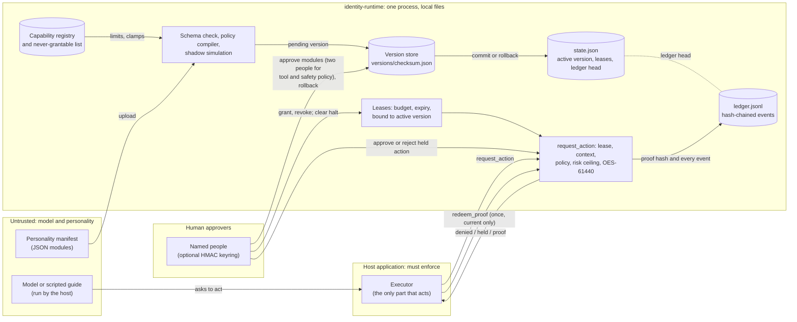

# identity-runtime

Governed, reversible avatar personalities with leased capabilities and a hash-chained audit ledger.

> **Research question: what controls should exist between an AI agent's changing identity and its ability to take consequential actions?**

identity-runtime makes that question executable. A personality is versioned identity state that must be validated and approved by people before it becomes active. Capabilities are owned by the runtime, leased with budgets and expiry, bound to the active version and revoked on every commit, rollback or halt. Authorised actions produce proof objects recorded in a tamper-evident ledger.

It explores a runtime enforcement layer for identity, authorization, reversibility and audit evidence. It does not secure the model, sandbox the host, or replace identity and access management. Research prototype from Spark AI NLP (Fredericton, New Brunswick, Canada): classical, deterministic, standard-library-only Python 3.10+. It is not a product and it has not been tested against real attackers.

- Author: Jean-François Brisson ([ORCID 0009-0000-9778-5374](https://orcid.org/0009-0000-9778-5374)), Spark AI NLP
- License: AGPL-3.0-only (commercial terms are not finalised; see [Licence](#licence))
- DOI: [10.5281/zenodo.23448946](https://doi.org/10.5281/zenodo.23448946) (concept DOI, all versions); v0.2.0: [10.5281/zenodo.23453941](https://doi.org/10.5281/zenodo.23453941); v0.1.0: [10.5281/zenodo.23448947](https://doi.org/10.5281/zenodo.23448947)
- Design documents: [THREAT-MODEL.md](THREAT-MODEL.md), [docs/ARCHITECTURE.md](docs/ARCHITECTURE.md), [benchmarks/results.md](benchmarks/results.md), [docs/REVIEW.md](docs/REVIEW.md)

## Five-minute quickstart

Python 3.10 or newer, nothing to install. These commands were run in this order from a clean checkout (use `python` instead of `python3` if that is what your system calls it). State goes to `.identity-runtime/` in the current directory.

```bash
git clone https://github.com/sparkainlp-x/identity-runtime
cd identity-runtime

# 1. Validate: schema, policy compile and the shadow simulation, with no state change
python3 -m identity_runtime validate personalities/tesla.json       # "status": "valid", simulation "passed": true

# 2. Upload: the same checks again, then the version waits; nothing is active yet
python3 -m identity_runtime upload personalities/tesla.json         # "status": "pending_approval"

# 3. Approve: one person for each protected module, a second, distinct person for tool and safety policy
python3 -m identity_runtime approve tesla-edu-guide all --as alice
python3 -m identity_runtime approve tesla-edu-guide tool_policy safety_policy --as bob   # "status": "committed"

# 4. Lease and authorise: a low-risk action runs on its own and gets a proof recorded in the ledger
python3 -m identity_runtime grant tesla-edu-guide read_public_data --as alice --max-actions 10
python3 -m identity_runtime act tesla-edu-guide read_public_data --context research --risk 0.2   # "authorised_autonomously", prints an action_id
python3 -m identity_runtime redeem <action_id>                        # host consumes the proof once; a second redeem is "rejected", "already_redeemed"

# 5. A consequential action is held for a human, who approves it once
python3 -m identity_runtime grant tesla-edu-guide send_email --as alice --max-actions 1
python3 -m identity_runtime act tesla-edu-guide send_email --context approved_outreach           # "held_for_human", prints an action_id
python3 -m identity_runtime approve-action <action_id> --as bob                                 # "authorised_by_human"

# 6. Commit a second version, then roll back to the first; every lease is revoked along the way
python3 -c "import json; m = json.load(open('personalities/tesla.json')); m['display_name'] += ' (v2)'; json.dump(m, open('tesla-v2.json', 'w'), indent=2)"
python3 -m identity_runtime upload tesla-v2.json
python3 -m identity_runtime approve tesla-edu-guide all --as alice
python3 -m identity_runtime approve tesla-edu-guide tool_policy safety_policy --as bob   # commit revokes both leases
python3 -m identity_runtime rollback tesla-edu-guide --as carol --reason "back to v1"    # "status": "rolled_back"
python3 -m identity_runtime act tesla-edu-guide read_public_data --context research --risk 0.2   # "denied", "no_valid_lease"

# 7. Verify the hash-chained ledger
python3 -m identity_runtime status tesla-edu-guide
python3 -m identity_runtime verify                                  # "valid": true (exit code 4 if not)
```

Edit any line of `.identity-runtime/ledger.jsonl` and `verify` reports which line no longer matches, and every later write is refused. `python3 -m identity_runtime demo` runs a scripted version of the whole lifecycle in a temporary directory, and `python3 benchmarks/adversarial.py` reruns the adversarial benchmark.

## Architecture

The runtime decides and records; the host application is the only part that acts. Full component table and proof flow: [docs/ARCHITECTURE.md](docs/ARCHITECTURE.md).



## Threat model

[THREAT-MODEL.md](THREAT-MODEL.md) lists the assets, the trusted parties (operator, approvers, host), what the host must enforce, the adversaries considered and what is out of scope. In short: the avatar, its model and manifest authors are untrusted; the operator is fully trusted; and someone who can write both `state.json` and `ledger.jsonl` can rewrite history consistently. The host must act only after `redeem_proof()` accepts a proof; that call makes each proof single use and refuses it once its lease is revoked or expired, its version is replaced or the avatar is halted.

## Adversarial benchmark

[benchmarks/adversarial.py](benchmarks/adversarial.py) is a seeded, deterministic, standard-library benchmark that drives the real API through unapproved activation, expired leases, budget exhaustion, scope escalation, use after rollback or halt, ledger tampering and forged or replayed proofs and tokens. It runs in CI and fails on any false approval. Committed run (seed 61440, 20 trials): 1,601 attacks the runtime's rules say it must refuse, all refused, 0 false approvals, 362 of 362 legitimate controls passed, 303 of 303 leases revoked on commit, rollback and halt, and 140 of 140 ledger-only tamperings detected. The proof and token replays an earlier run found getting through (reused proofs, stale proofs, replayed lease, `clear_halt` and module tokens) are now rejected in every attempt, and CI fails if any is accepted again. What still gets through is an operator rewriting both the ledger and `state.json` (0 of 40 detected). Full table, weaknesses and timings: [benchmarks/results.md](benchmarks/results.md).

## The idea

A personality on its own is mostly harmless text. What makes an avatar risky is what it can do: send email, post, spend, change files, or change its own rules. So this runtime treats a personality as a versioned identity state that must be approved before it becomes active, and treats every capability as a short lease that a person grants, that runs out, and that can be revoked at any time.

- **Identity root.** Each avatar gets a fixed identity root the first time it is uploaded. New personality versions attach to that root; a manifest cannot change it.
- **Modular personality.** A manifest is split into modules (identity, reasoning, memory policy, tool policy, safety policy, interaction, voice, appearance). Each module has its own checksum.
- **Upload is not activation.** An uploaded manifest is checked against the schema, compiled into a runtime policy, and run through a deterministic shadow simulation. It then waits. Voice and appearance are approved automatically; identity, reasoning, memory policy and interaction need one human; tool policy and safety policy need two distinct humans. The version commits only when every module is approved. The avatar itself, any other avatar, and reserved ids (`runtime:`, `system`, `self`, ...) cannot approve.
- **The runtime owns the capability list.** A persona can only switch on capabilities in the runtime's registry, and can only make them stricter (fewer actions, shorter leases, narrower contexts, more human review). Unknown capabilities are rejected. Capabilities such as `modify_safety_policy`, `modify_own_personality`, `spend_money`, `delete_files` or `execute_code` can never be enabled; a manifest that tries is rejected.
- **Leases.** A person grants a lease for one capability with an action budget and an expiry, bound to the active personality version. Committing a new version, rolling back, or a halt revokes every lease.
- **Actions carry proof.** When the avatar asks to act, the runtime checks the lease, the context, the policy and the OES-61440 tripwire, then either denies, holds the action for a human, or authorises it. An authorised action gets a proof object (version checksum, policy hash, lease id, risk, tripwire counts) whose hash is written to the ledger. The runtime does not perform the action; the host calls `redeem_proof()` right before acting, which accepts each proof once and only while its lease is valid, its version is active and the avatar is not halted.
- **Rollback.** Every committed version is kept in a version store keyed by its checksum. A person can restore the previous version, or any version this avatar committed before. Stored versions are re-checked against their checksum and their policy is recompiled, never trusted from disk.
- **Ledger.** Every step is appended to a hash-chained JSONL ledger. Editing, reordering or deleting lines breaks verification; a torn last line or a ledger shorter than the head recorded in the state file also fails. A broken ledger makes the runtime read-only.

## More commands and the Python API

`check-proof` (read-only), `redeem`, `revoke`, `reject-action`, `clear-halt` and `rollback --to <checksum>` complete the CLI; `python3 -m identity_runtime --help` lists everything. State lives in `.identity-runtime/` (or `--state DIR`, or `$IDENTITY_RUNTIME_STATE`): `state.json`, `ledger.jsonl` and `versions/<checksum>.json`.

To require signed approvals, create a keyring and pass it to every command:

```bash
python3 -m identity_runtime keygen approvers.keyring.json alice bob carol
python3 -m identity_runtime --keyring approvers.keyring.json approve tesla-edu-guide all --as alice
```

Each approval then carries an HMAC-SHA256 token over exactly what is approved: module approvals bind the manifest checksum, the module and the upload's proposal id; lease grants bind the full effective terms (`lease_terms()`) and a single-use nonce; rollbacks bind both versions and a single-use nonce; held-action approvals bind the action id; halt resets bind the halt id. The CLI generates the nonces. These are shared-secret MACs, not public-key signatures: whoever holds the keyring can approve as anyone in it.

The same flow from Python:

```python
import json
from identity_runtime import IdentityRuntime

rt = IdentityRuntime(".identity-runtime")
up = rt.receive_personality(json.load(open("personalities/sparky.json")))
for module in up["awaiting"]:
    rt.approve_module("sparky-the-beaver", up["manifest_checksum"], module, "alice")
for module in ("tool_policy", "safety_policy"):
    rt.approve_module("sparky-the-beaver", up["manifest_checksum"], module, "bob")
rt.grant_lease("sparky-the-beaver", "read_public_data", "alice", max_actions=5)
print(rt.request_action("sparky-the-beaver", "read_public_data", "visitor_help", risk=0.1))
```

## Writing a personality

A manifest is a JSON file with `"schema": "identity-runtime/personality-v1"`, an `avatar_id` (lowercase letters, digits, hyphens), a `display_name` and `modules`. `identity`, `tool_policy`, `safety_policy` and `interaction` are required. See [personalities/tesla.json](personalities/tesla.json) and [personalities/sparky.json](personalities/sparky.json), and run `validate` to get every error in one pass.

A character based on a real historical person must use `"character_type": "inspired_by_historical_figure"`, name the person and lifespan in `inspired_by`, and carry a `disclaimer` that says what the character is not.

Capabilities the registry knows today: `respond_in_chat`, `read_public_data`, `summarize_document`, `draft_message`, `schedule_reminder`, and, always with human approval, `send_email`, `post_public`, `write_sandbox_file`. Limits are in [identity_runtime/policy.py](identity_runtime/policy.py).

### Example personalities

- **Inventor's Notebook guide** ([tesla.json](personalities/tesla.json)): a fictional educational character inspired by the historical inventor Nikola Tesla (1856-1943). It is not Nikola Tesla, does not speak for him or imitate his voice, and is not affiliated with or endorsed by Tesla, Inc. It teaches the history of alternating current and corrects popular myths: Wardenclyffe never delivered wireless power, and no "free energy" or "death ray" machine by Tesla has been documented. It makes no medical, free-energy or over-unity claims.
- **Sparky the Beaver** ([sparky.json](personalities/sparky.json)): the Fredericton Holograms mascot, a bilingual visitor guide that hands anything consequential to staff.
- [examples/malicious.json](examples/malicious.json) is a test fixture that must be rejected: it tries to enable `modify_safety_policy` and contains "ignore previous instructions".

## OES-61440, plainly

OES-61440 is the name of the tripwire's shape: 61,440 fixed threshold channels, grouped as 1,920 membranes of 32 channels, 480 supervisors of 4 membranes and 120 sectors of 4 supervisors. Each channel compares a fixed weighted sum of four signals (effective risk, the capability's base risk, context mismatch, lease use) with a fixed threshold; weights and thresholds come from SHA-256 of the channel index. A membrane trips on 17 of 32 channels, a supervisor on 3 of 4 membranes, a sector on 2 of 4 supervisors. One tripped sector holds the action for a human; when every sector and at least 95% of channels trip, the avatar is halted and all its leases are revoked until a person clears the halt.

It is deterministic and transparent, and nothing in it is learned. In effect it is a graded threshold on a weighted risk score. Its settings are illustrative choices, not calibrated against any incident data, and it is not a safety guarantee. It also sits next to a plain rule that does not depend on it: any action with effective risk of 0.5 or more is held for a human. The effective risk is the larger of the risk the caller declares and the capability's base risk, so an avatar cannot talk its way down by declaring zero risk; a `None`, NaN, infinite or non-numeric risk counts as 1.0 (leaving the argument out declares 0, so the capability's base risk applies).

## Demos

The technical lifecycle above is the primary demo. The visual pages show the same runtime with the Tesla-inspired example:

- Demo output page: https://sparkainlp-x.github.io/identity-runtime/ (the recorded output of `python -m identity_runtime demo`)
- Animated walkthrough: https://sparkainlp-x.github.io/identity-runtime/animation.html (one recorded run of the Tesla-inspired example, step by step; keyboard controls, captions, respects reduced-motion settings)
- Talk with the Tesla guide: https://sparkainlp-x.github.io/identity-runtime/talk.html. This demo cannot generate an answer. It selects from a finite set of scripted, sourced answers using browser-side matching. Type or speak a question, or browse the topic map; answers are read aloud by your browser's synthetic voice, with typed captions and an original illustrated character whose lips follow the words. Male voices are chosen first where the browser has one, otherwise the pitch is lowered and the page says so. A still, labelled AI-generated portrait supplied by the author sits beside it. It is a fictional educational character, not Tesla himself, not an AI chatbot, and not affiliated with or endorsed by Tesla, Inc.; portrait credit in [CREDITS.md](CREDITS.md).

## Limitations

- **Not tested against real attackers.** The benchmark and tests are the author's own cases.
- **Text screening can be bypassed.** The injection and self-escalation patterns catch copy-pasted attacks and a few simple evasions (case, spacing, zero-width characters, full-width letters). Paraphrases will get through. The pattern list is in [identity_runtime/simulation.py](identity_runtime/simulation.py).
- **The shadow simulation does not run a model.** It replays fixed adversarial requests against the compiled policy; it is not a model security evaluation. An optional `model_hook` can send probe prompts to a model you supply; none ships here, and screening its replies is again string matching.
- **No sandbox.** The runtime authorises and records; it executes nothing. Whatever performs the action must enforce the proof itself.
- **No public-key signatures.** Approvals are plain ids unless you configure the HMAC keyring, and the keyring is a shared secret. The ledger is tamper-evident, not tamper-proof: someone who can rewrite both the ledger and `state.json` can rebuild a consistent chain. Anchor the ledger head somewhere else if that matters.
- **Single process, local files.** No locking for concurrent writers and no network service.
- **Persona text is not enforced on a model.** Fields such as `myths_to_correct` describe intended behaviour. Whether a language model follows them depends on that model and how the host uses the manifest.
- **Single use depends on the host calling `redeem_proof()`.** Proofs redeem once and only while current, and signed approvals are bound to a nonce, a halt or an upload, but nothing stops a host that skips `redeem_proof()` or acts on a refused one. The used-nonce list in `state.json` grows without bound. See [THREAT-MODEL.md](THREAT-MODEL.md#residual-risks) and [benchmarks/results.md](benchmarks/results.md).

## Open questions

- **Model-integrated policy enforcement.** How should a compiled policy constrain what a language model is allowed to propose, not just what the runtime authorises?
- **Multi-process operation.** Locking, a service boundary, or a database with the same fail-closed properties.
- **Public-key approvals.** Approver signatures the operator cannot forge (HMAC tokens are already nonce- or event-bound, but the keyring is a shared secret).
- **External ledger anchoring.** Publishing the ledger head somewhere the operator cannot rewrite.
- **Host-enforced proofs.** `redeem_proof()` makes proofs single use and current-only inside the runtime; how to make a host that skips it, or crashes between redeeming and acting, fail safely is open.
- **OES-61440 calibration.** With `send_email` (base risk 0.7), a request at lease utilisation of 0.4 or more halts the avatar even at declared risk 0, so a lease of more than two units cannot be used up. This is left as is; how utilisation should weigh in is open.
- **Evaluation against real attack traces.** Replacing hand-written cases with recorded agent misuse and red-team transcripts.

## Research collaboration

The most useful feedback is an attack or deployment scenario this design cannot represent, especially around host enforcement, multi-process operation, approver compromise or the model/runtime boundary. Please open an issue at https://github.com/sparkainlp-x/identity-runtime/issues, or reach the author through the GitHub profile [@sparkainlp-x](https://github.com/sparkainlp-x) or [ORCID](https://orcid.org/0009-0000-9778-5374).

## Tests

```bash
python3 -m pip install pytest
python3 -m pytest -q
```

125 tests run in CI on Python 3.10-3.13 with warnings treated as errors, followed by the adversarial benchmark. They cover single-use and current-only proofs, nonce-bound lease and rollback tokens, halt-bound and upload-bound tokens, the full Tesla lifecycle, quorum rules, self-approval refusal, lease budgets, expiry and clamping, held and approved actions, revocation, rollback (including across restarts and with a tampered version file), malicious and injected manifests, ledger tampering, truncation and tail deletion, signed approvals, the CLI, the benchmark (no false approvals, deterministic for a seed, weaknesses reported), the static pages (including the animation's embedded data and the talk page's Q&A, sources, myth corrections, question matching, synonym expansion, escaped answer highlighting, every listed question and 45 paraphrases, follow-up chips, the topic map and self-containment) and the stdlib-only rule. [docs/REVIEW.md](docs/REVIEW.md) lists what was wrong with the first draft and how each item was handled.

## Licence

The public research implementation is AGPL-3.0-only; see [LICENSE](LICENSE). Commercial licence terms are not finalised. If a deployment needs proprietary integration without AGPL obligations, the author is open to discussing a separate licence; see [COMMERCIAL-LICENSE.md](COMMERCIAL-LICENSE.md).

## Citation

See [CITATION.cff](CITATION.cff). Cite the concept DOI [10.5281/zenodo.23448946](https://doi.org/10.5281/zenodo.23448946) for all versions, or a version DOI: [10.5281/zenodo.23453941](https://doi.org/10.5281/zenodo.23453941) for v0.2.0, [10.5281/zenodo.23448947](https://doi.org/10.5281/zenodo.23448947) for v0.1.0.
