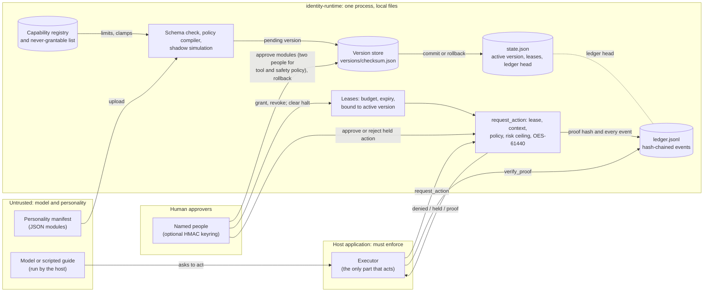

# Architecture

identity-runtime sits between an avatar (a personality plus whatever model or script speaks for it) and the host application that actually performs actions. It decides and records; it never acts. This page shows where each boundary is and where proofs flow. The threat model that goes with it is in [THREAT-MODEL.md](../THREAT-MODEL.md).

## Components

| Component | Code | Trust | What it does |
|---|---|---|---|
| Personality manifest | `personalities/*.json`, [schema.py](../identity_runtime/schema.py) | Untrusted input | Versioned identity state split into modules, each with its own checksum. Uploading it activates nothing. |
| Model or scripted guide | not in this repository | Untrusted | Produces the avatar's words and asks the host to act. The runtime never sees or controls it; persona text is not enforced on it. |
| Schema check, policy compiler, shadow simulation | [schema.py](../identity_runtime/schema.py), [policy.py](../identity_runtime/policy.py), [simulation.py](../identity_runtime/simulation.py) | Runtime | Rejects malformed manifests, unknown or never-grantable capabilities and known injection strings; clamps limits; replays fixed probes against the compiled policy. Not a model security evaluation. |
| Capability registry | [policy.py](../identity_runtime/policy.py) | Runtime-owned | The only capabilities a personality can enable, with base risk, caps and mandatory human approval. A manifest can only make them stricter. |
| Version store | [store.py](../identity_runtime/store.py) | Runtime, local files | Every uploaded version by checksum. Re-checked against its checksum and recompiled on every load. |
| Approvals and commit | [runtime.py](../identity_runtime/runtime.py) | Humans | One person per protected module, two distinct people for tool and safety policy; voice and appearance are automatic. Avatars, the identity root and reserved ids cannot approve. Rollback needs one person. |
| Leases | [runtime.py](../identity_runtime/runtime.py) | Humans grant, runtime enforces | One capability, an action budget, an expiry, bound to the active version. Commit, rollback and halt revoke every lease and cancel held actions. |
| Decision (`request_action`) | [runtime.py](../identity_runtime/runtime.py), [fabric.py](../identity_runtime/fabric.py) | Runtime | Denies (halted, no committed identity, never grantable, not in policy, wrong context, no valid lease); holds for a human (policy says so, effective risk at or above 0.5, or an OES-61440 checkpoint); halts the avatar (OES-61440 halt); otherwise authorises and issues a proof. |
| Ledger | [ledger.py](../identity_runtime/ledger.py) | Tamper-evident, not tamper-proof | Hash-chained JSONL of every event. The head is also saved in `state.json`; a mismatch, a broken chain or a torn line makes the runtime read-only. |
| Host executor | your application | Must enforce | The only part that acts. It should act only on a proof that `verify_proof()` accepts, and it must add what the runtime does not: single use, freshness and sandboxing. |

## How a proof flows

1. The model asks the host to do something. The host calls `request_action(avatar, capability, context, risk, description)`.
2. The runtime checks the active version, the compiled policy, the context and the lease, computes the effective risk (the larger of the declared risk and the capability's base risk) and runs OES-61440.
3. If it authorises, it builds a proof (proof version, action id, avatar, identity root, manifest checksum, policy hash, lease id, capability, context, description, declared and effective risk, tripwire counts, decision), hashes it, and appends an `action_authorised` event carrying the proof to the ledger. A held action gets its proof hash only when a person approves it with `approve_action`.
4. The host passes the proof to `verify_proof()`, which recomputes the hash and looks for it in an `action_authorised` ledger event.
5. The host executes. `verify_proof()` says the action *was* authorised; it does not mark the proof used and does not re-check that the lease or version is still current, so the host must do both (see the threat model and [benchmarks/results.md](../benchmarks/results.md)).

## Files

State lives in one directory (`.identity-runtime/` by default): `state.json` (active versions, leases, held actions, the recorded ledger head), `ledger.jsonl` and `versions/<checksum>.json`. One process at a time; there is no locking and no network service.
